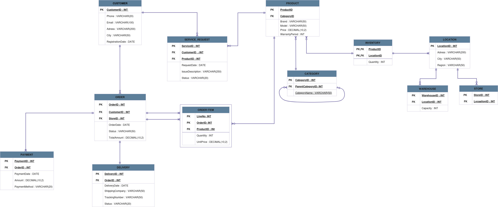

# Retail Management: sales and after-sales admin dashboard

Team project for STAT 311 (Modern Database Systems) at METU, Department of Statistics, January 2026. We designed a relational database for an electronics and home appliances retailer and built a small admin panel on top of the data.

Team (Group 2): Duhan Onat Karadayı, Doğa Aksan, Gülizar Uz, Mert Cevdet Gürsel, Rümeysa Daştan.

All customers, orders and products in this repo are made up. We generated a synthetic dataset for the course.

## Database

`database.sql` is the PostgreSQL schema with sample data. It creates 12 tables: Customer, Category, Product, Location, Store, Warehouse, Orders, Order_Item, Payment, Delivery, Service_Request and Inventory, with primary and foreign keys.



The full write-up, including the ER model, schema and the SQL queries we used to answer our research questions, is in [data/project-report.pdf](data/project-report.pdf).

## Dashboard

The web panel is plain HTML, CSS and JavaScript. It doesn't connect to the database. It reads JSON exports of the same tables from `data/` (customers, products, orders, order items, payments, deliveries, service requests). All page logic is in `dashboard.js`.

- `index.html`: sales overview with order count, revenue, delivered and in-transit counts, orders by status, revenue by payment method, and a product stock table that flags low stock.
- `orders.html` and `order.html?id=N`: order list and order detail with items, payment and delivery.
- `service-dashboard.html`: service requests by status and by product, plus a warranty table that works out each sold item's expiry date from the order date and the product's warranty period, and marks it active, expiring soon or expired.
- `service-requests.html` and `service.html?id=N`: service request list and detail.
- `about.html`: project summary, team, report download and ER diagram.

## Run it

The pages load the JSON with `fetch`, so they need to be served over HTTP. Opening the files directly won't work. From the repo root:

```bash
python3 -m http.server 8000
```

Then open http://localhost:8000. VS Code Live Server works too.

To load the schema into PostgreSQL:

```bash
psql -d <your_db> -f database.sql
```
